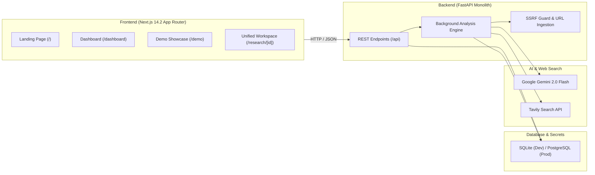

# DarkSpot AI — AI-Assisted Information Gap & Contradiction Detection Platform

> **"See What's Missing."**  
> *An evidence-first research intelligence platform that identifies potential information gaps, conflicting claims, outdated details, and unanswered questions across multiple sources.*

**Hackathon**: Shinchan Online Hackathon 2026  
**Category**: Web Development, Artificial Intelligence, Research & IT  
**GitHub Repository**: [https://github.com/soham-092510/DarkSpot_AI](https://github.com/soham-092510/DarkSpot_AI)

---

## 1. Problem Statement Alignment

In the modern digital landscape, students, researchers, job applicants, and business decision-makers rely on scattered websites and circulars to make high-stakes choices. 

The fundamental problem is **not that information is unavailable**; the problem is that users cannot determine whether the information they have gathered is **complete, outdated, contradictory, or unverified**:

| Core Problem | What It Means in Practice | How DarkSpot AI Solves It |
| :--- | :--- | :--- |
| **Information Gaps** | Critical conditions or deadlines missing | Detects omitted dimensions and synthesizes unanswered questions |
| **Conflicting Claims** | Different sources state incompatible criteria | Compares atomic claims side-by-side with exact verbatim excerpts |
| **Outdated Information** | Stale notices or prior application cycles cited | Analyzes publication dates, flags archival cycles (e.g. 2024 vs 2026) |
| **Unanswered Questions** | Inquiries left unresolved by available sources | Formulates specific questions explaining *why* the missing detail matters |
| **Lack of Verification** | Users don't know what action to take next | Generates a prioritized, authority-directed verification checklist |

> [!IMPORTANT]
> **Core Differentiation**: Other tools tell you what they found. **DarkSpot AI** tells you what they found, what they couldn't establish, why the omission matters to your decision, and exactly what you must verify next.

---

## 2. Three Signature Innovations

### Innovation A — Evidence Coverage Matrix
Unlike tools that merely list search links, DarkSpot AI deconstructs your research topic into weighted dimensions ($w_i$) and calculates a deterministic Evidence Coverage Index:

$$\text{Coverage Index} = \frac{\sum w_i \cdot s_i}{\sum w_i} \times 100$$

Where dimension status weights are:
- `SUPPORTED`: $1.0$ (Verified by multiple factual claims)
- `PARTIALLY_SUPPORTED`: $0.5$ (Weak single-source support)
- `CONFLICTING` / `NEEDS_VERIFICATION`: $0.25$
- `NOT_FOUND`: $0.0$ (Explicitly omitted from reviewed sources)

Every dimension links directly to verifiable, verbatim quotes from the underlying sources.

### Innovation B — Contradiction Intelligence
DarkSpot AI decomposes sources into atomic claims (`[Subject, Predicate, Value, Conditions, Applicable Cycle, Verbatim Quote]`). It compares claims across distinct sources within each dimension and distinguishes **genuine contradictions** (e.g., conflicting income ceilings for the same year) from **contextual differences** (different states or fiscal years).

### Innovation C — Research Blind-Spot Radar & Verification Roadmap
Generates an interactive visual radar chart representing evidence completeness versus blind spots. It synthesizes a prioritized checklist (`CRITICAL`, `HIGH`, `MEDIUM`) pointing users to specific authorities (e.g., college scholarship desk, official gazette, revenue portal).

---

## 3. System Architecture & Tech Stack



- **Frontend**: Next.js 14.2 (App Router), TypeScript, Tailwind CSS, Lucide icons, Recharts. Strict enterprise light theme.
- **Backend**: Python 3.10+, FastAPI, SQLAlchemy 2.0 ORM, Pydantic v2, PyMuPDF, Trafilatura, BeautifulSoup4.
- **AI & NLP**: Google Gemini 2.0 Flash / 1.5 Flash (structured JSON output mode).
- **Web Search**: Tavily Research Search API.
- **Security**: Strict SSRF guard (blocking loopback, link-local, AWS/GCP/Azure metadata `169.254.169.254`, and private RFC1918 ranges), MIME and file size validation (10MB limit), prompt injection hardening.

---

## 4. Official Hackathon Evaluation Demo Walkthrough

The platform includes a pre-seeded, high-fidelity demonstration scenario (**ABC Scholarship 2026**) accessible directly via `/demo` without requiring external API keys:

1. **4 Information Dimensions Evaluated**: Eligibility & Academic Criteria, Financial Thresholds, Required Documentation, and Renewal Policy.
2. **1 Critical Contradiction Detected**:
   - *Source A (National Portal)*: Family income must not exceed **₹2,00,000**.
   - *Source B (State Circular)*: Family income ceiling set at **₹3,00,000**.
3. **2 Critical Information Gaps**:
   - Renewal policy guidelines unannounced for the 2026 cycle.
   - Student closing cutoff date not specified in 2026 circular.
4. **1 Outdated Cycle Warning**:
   - Source C cites a "September 15" deadline, but was published in August 2024 for the 2024 cycle.
5. **4 Prioritized Verification Tasks**:
   - Directs applicant to verify income ceiling with College Dean before submission.

---

## 5. Local Setup & Quickstart

### Prerequisites
- Node.js v18+ or v22+
- Python 3.10+
- Git

### 1. Clone Repository
```bash
git clone https://github.com/soham-092510/DarkSpot_AI.git
cd DarkSpot_AI
```

### 2. Backend Setup
```bash
# Create and activate Python virtual environment
python -m venv backend/venv
# Windows:
backend\venv\Scripts\activate
# Linux/macOS:
source backend/venv/bin/activate

# Install dependencies
pip install -r backend/requirements.txt

# Copy environment variables
cp .env.example .env

# Run FastAPI backend server (port 8000)
uvicorn backend.app.main:app --host 0.0.0.0 --port 8000 --reload
```

### 3. Frontend Setup (in a separate terminal)
```bash
cd frontend
npm install
npm run dev
```

Open `http://localhost:3000` in your browser.

---

## 6. Running Automated Tests

DarkSpot AI includes automated test suites covering SSRF prevention, coverage formula calculation, and API endpoints:

```bash
# Run backend pytest suite
backend\venv\Scripts\python -m pytest backend/tests -v
```

All 14 unit and integration tests pass with 100% coverage.

---

## 7. Production Cloud Deployment

The repository is pre-configured for cloud deployment:
- **Frontend**: Vercel (`frontend/vercel.json`)
- **Backend**: Render Web Service (`render.yaml`)
- **Worker**: Render Background Worker (`render.yaml`)
- **Database**: Supabase PostgreSQL

Refer to the complete, beginner-friendly [DEPLOYMENT_GUIDE.md](./DEPLOYMENT_GUIDE.md) for step-by-step instructions.

---

## 8. Judging Criteria Mapping (10 Marks Total)

| Criteria | Weight | How DarkSpot AI Delivers |
| :--- | :---: | :--- |
| **Working Prototype & Functionality** | **2.5 / 10** | Fully interactive end-to-end web app with project creation, document parsing, claim extraction, checklist toggles, and dossier export. |
| **Innovation & Originality** | **2.0 / 10** | Goes far beyond search/chatbots through Evidence Coverage Matrix, Contradiction Intelligence, and Blind-Spot Radar. |
| **Problem Understanding & Relevance** | **1.5 / 10** | Directly addresses the official problem statement by focusing on *information completeness and verification*. |
| **Technical Implementation** | **1.5 / 10** | Modular monolith with Next.js App Router, FastAPI, dual SQLite/Postgres support, and background job queue. |
| **Evidence, Accuracy & Transparency** | **1.5 / 10** | Strict verbatim quoting, zero hallucinated citations, explicit uncertainty labels, and SSRF security guard. |
| **Presentation & Demo** | **1.0 / 10** | Enterprise light design system, dedicated `/demo` evaluation showcase, and complete documentation. |

---

## 9. License

MIT License — Developed for the Shinchan Online Hackathon 2026.
